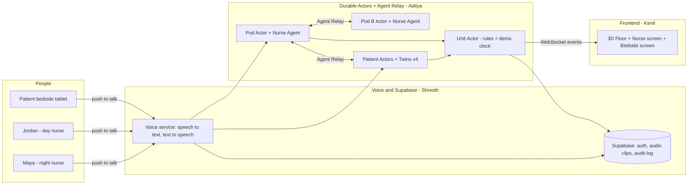

# 🌿 Sanjeevni: Master Plan

**Haunted Hacks: Real-Time AI Edition, Oct 31, 2026**
**Tagline:** *Nothing gets lost at 7am.*

| Teammate | Owns | Detail file |
|---|---|---|
| **Aditya** | Backend: Terse Durable Actors + Agent Relay + agent brains | `aditya.md` |
| **Shresth** | Backend: voice (nurse + patient), Supabase, integration, video + submission | `shresth.md` |
| **Kenil** | Frontend: 3D floor, screens, paths, animations | `kenil.md` |
| **Everyone** | Shared IDs, messages, events, and demo clock | `contracts.md` |

---

## 0. Why the name "Sanjeevni"

In the Ramayana, Lakshmana lay dying, and the Sanjeevani herb had to reach him **before sunrise**. Hanuman carried it through the night and he lived.

Our agents do the same thing every night: they carry everything that matters through the night so it reaches the morning nurse by 7am.

**Pitch line:** *"Sanjeevni carries every patient's story through the night, so nothing gets lost at 7am."*

---

## 1. The idea in 30 seconds

Every morning at 7am, a tired night nurse hands their patients to a fresh day nurse. In that rushed handoff, details get lost: a dose that was never recorded, a fall-risk patient who got a sleeping pill, a medicine that was changed overnight. Those lost details hurt people.

**Sanjeevni** gives every patient an AI **Patient Twin** and every group of rooms an AI **Nurse Agent**:
- Nurses just **talk**. The agents remember.
- **Twins** protect their patient all night: they catch missed doses, spot risks, and listen to the patient.
- The **Nurse Agent** never clocks out. At 7am, it briefs the new nurse with full context.
- **The nurse changed. The agent didn't.**

---

## 2. The problem

A hospital runs 24 hours, but nurses work 12-hour shifts. Twice a day, every patient's whole story has to move from one person's head to another's. This is the **handoff**, and at 7am the night nurse is exhausted and the day nurse is just arriving.

| Fact | Source |
|---|---|
| Communication failures contribute to an estimated **50–80%** of sentinel events, the most serious hospital harms. | Patient Safety & Quality Healthcare [1] |
| The Joint Commission says miscommunication contributes to about **two-thirds** of serious adverse events in hospitals, and handoffs are especially prone to lapses. | Harvard Medical School News [2] |
| A 2016 study found communication failures were at least partly responsible for **30% of malpractice claims**, **1,744 deaths**, and **$1.7 billion** in costs. | Joint Commission Sentinel Event Alert 58 [3] |
| In malpractice claims, **49%** had communication failures. **40%** of those involved a failed handoff, and **77%** could potentially have been prevented with a handoff tool. | Humphrey et al., *J. Patient Safety* 2021 [4] |
| Adverse events happen in almost **1 in 4 hospital admissions**, and a quarter of those are preventable. | Joint Commission Journal on Quality and Patient Safety, 2024 [5] |
| **Falls** were the most common sentinel event in 2022, at **42%** of 1,441 reviewed events. | The Joint Commission [6] |
| After finding **70%** of sentinel events were caused by communication breakdowns, the Joint Commission **required** hospitals to use a standardized approach to handoffs. | OR Nurse journal [7] |

**The fix exists:**

| Fact | Source |
|---|---|
| A structured handoff program (I-PASS) **reduced adverse events by 47%**. | Harvard Medical School News [2] |
| Across 9 medical centers and 10,740 admissions, structured handoffs cut **preventable adverse events by 30%** and **medical errors by 23%**. | Joint Commission Sentinel Event Alert 58 [3] |

**The insight:** Structured handoffs save lives. But after a 12-hour night shift, no human can do one perfectly for every patient. AI agents can.

---

## 3. The architecture (simple)

**Rule:** Every agent lives inside a Durable Actor, but not every actor is an agent. We only use AI where a job needs judgment. Everything else is plain rules.

| Actor | AI agent inside? | How many | What it does |
|---|---|---|---|
| **Patient Actor** | ✅ **Patient Twin** | 1 per patient (4 in demo) | Remembers one patient deeply; protects them |
| **Pod Actor** | ✅ **Nurse Agent** | 1 per group of rooms (2 in demo) | Routes voice notes, ranks alerts, briefs each new nurse; never clocks out |
| **Unit Actor** | ❌ Rules only | 1 per floor | Assignments, handoff checklist, overload and look-alike checks, demo clock, live feed to 3D |

**Relationships:**

| Link | Type |
|---|---|
| Agent ↔ its actor | **1 to 1** |
| Patient Twins → Nurse Agent | **Many to 1** (4 Twins per pod) |
| Pods → Unit Actor | **Many to 1** |
| Nurse ↔ Nurse Agent | **1 to 1 at a time** (Maya at night, Jordan in the morning) |
| Nurse Agent ↔ Nurse Agent | **Many to many** (pods help each other) |

---

## 4. The two agents

### 🛏️ Patient Twin (one per patient)

**Role:** The patient's voice and memory. It knows **one patient, deeply.**

**Responsibilities:**
- **Remember:** Keeps the full story: medicines, allergies, vitals, every note, every event.
- **Watch the clock:** Uses actor alarms for doses, vitals, pain rechecks, and fall rounds, and flags anything overdue.
- **Protect its patient:** Checks every new note against the history and warns when it's risky (fall risk plus a new sleeping pill).
- **Spot trends:** Notices "blood pressure dropped on 3 checks in a row."
- **Listen to the patient:** Understands bedside requests ("I feel shaky") and adds context ("she's diabetic").
- **Answer questions:** "Was the 3am dose given?" "Did pain improve?"
- **Write its handoff section** at 6:45am.
- **Confirm read-back:** Checks that the new nurse correctly understood its patient.

**Can see:** Only its own patient.
**Can never:** Give or change medicines, diagnose, or make anything official without a nurse confirming.

### 👩‍⚕️ Nurse Agent (one per pod of rooms)

**Role:** The nurse's assistant and the pod's coordinator. It knows **every patient in the pod at a glance**, and it **never clocks out.**

**Responsibilities:**
- **Listen to the nurse:** Turns voice notes into clean notes.
- **Route notes:** Splits one sentence about two patients and sends each part to the right Twin.
- **Rank alerts:** When several Twins alert at once, decides which comes first ("Room 2 first").
- **Protect the nurse's attention:** Only interrupts for urgent things, bundling the rest.
- **Brief each new nurse:** At 7am, briefs Jordan with full context and answers his questions, asking Twins when needed.
- **Coordinate with other pods:** Asks other Nurse Agents for help over Relay ("Can you watch Room 2?").
- **Keep the pod's to-do list.**

**Can see:** Only its pod's rooms.
**Can never:** Make clinical decisions or see other pods' patients.

### 3 features that make them different

1. **Who it serves:** The Twin works for the **patient**. The Nurse Agent works for the **nurse**.
2. **What it sees:** The Twin knows **one patient deeply**. The Nurse Agent knows **every patient in the pod at a glance**.
3. **What it decides:** The Twin asks *"Is my patient okay?"* The Nurse Agent asks *"Who needs the nurse most right now?"*

### Why two agents and not one
1. **It prevents wrong-patient mistakes.** A Twin can't mix up patients, because it only knows one. Safety comes from the design.
2. **Patients can talk safely.** The bedside tablet talks to the patient's own Twin, which can't leak other patients' information.
3. **Everything happens at the same time.** When 3 alarms fire at 3:30am, each Twin handles its own patient in parallel instead of waiting in one queue.

### Can the Twin do operational tasks? Yes, with a clear line

| ✅ The Twin CAN | ❌ The Twin can NEVER |
|---|---|
| Remind: "6am dose due in 15 min" | Give, order, or change medicines |
| Flag: "3am dose not charted" | Diagnose |
| Warn: "Fall risk plus new sleeping pill" | Change the care plan |
| Pass on patient requests with context | Finalize notes without a nurse |
| Request pharmacy follow-up or an interpreter | See other patients |
| Remind about lab draws | |
| Answer questions about its patient | |
| Draft its handoff section | |

**Golden rule:** Agents **remind, warn, draft, and answer**. Humans **decide**.

---

## 5. The Unit Actor (rules, no AI)

These jobs are counting and checking, so they're plain code. Using AI here would be fake.

- **Assignments:** Which nurse is on which pod right now.
- **Handoff checklist:** Every room has a section, every open flag is acknowledged, and every Twin confirmed read-back. Then mark "accepted."
- **Overload check:** If one pod has 3 or more high-risk patients, post a floor notice.
- **Look-alike names:** "Grace Lee (Room 8) and Grace Li (Room 3)": warn both pods.
- **Handoff deadline:** At 7:30am, warn if any room isn't accepted.
- **Demo clock:** Owns the simulated night time (see `contracts.md`).
- **Live feed:** Streams every event to the 3D frontend over WebSocket.

**Pitch line:** *"We only used an agent where a job needs judgment. Everything else is plain rules inside the actors."*

---

## 6. Why Terse Durable Actors are load-bearing

> Terse's own description: a Durable Actor is a tiny server that handles one request at a time and has its own SQLite database. Each agent can have its own Durable Actor, and each user can connect to it by WebSocket.

| Actor feature | What it does in Sanjeevni |
|---|---|
| **Memory that survives** | Shifts end, nurses leave, servers crash, but each patient's story and each pod's context never disappear. *This is the problem we solve.* |
| **Alarms** | Doses, vitals, pain rechecks, fall rounds, and the 7am shift change fire on their own. This is what catches the missed 3am dose. |
| **One request at a time** | Two notes can never overwrite each other on the same patient. |
| **One actor per patient** | Each patient's data is isolated, which helps privacy and scales to any number of floors. |
| **WebSocket** | The 3D floor updates live the moment anything changes. |

**The remove test:** Remove the actors and there's no memory across shifts, no alarms, no agent that outlives the nurse. **The product breaks.**

---

## 7. Why Agent Relay is load-bearing

1. **Actors handle one request at a time.** If two actors call each other directly and wait, they can freeze. Messages avoid that, and that's how actors are designed to talk.
2. **"Who's my nurse right now?" changes at 7am.** Twins message the pod's Nurse Agent by name, whoever is on shift.
3. **Nothing gets lost when an agent is busy.** Messages wait in the inbox.
4. **Every conversation is saved and searchable.** That's the accountability record: who was told what, and when.
5. **Humans can watch.** The floor channel powers the live message beams on the 3D screen.

**The key messages:**

| From → To | Example |
|---|---|
| Nurse Agent A → Room 6 Twin | "New note: gave zolpidem for sleep at 23:30." |
| Room 6 Twin → Nurse Agent A | "⚠️ Fall risk plus new sleeping pill (age 81). Bed alarm on?" |
| Room 4 Twin → Nurse Agent A | "⏰ 3am potassium not charted. Given?" |
| Room 8 Twin → Nurse Agent A | "Patient says 'I feel shaky.' She's diabetic." |
| Room 2 Twin → Nurse Agent A | "Blood pressure dropped on 3 checks: 128, 112, 98." |
| Nurse Agent A → Nurse Agent B | "Maya is with Room 8. Can your nurse check Room 2's BP?" |
| Nurse Agent B → Nurse Agent A | "Yes, Sam is heading to Room 2." |
| Each Twin → Nurse Agent A | "Handoff section ready." |
| Nurse Agent A → Room 4 Twin | "Jordan asks: did pain improve?" |
| Room 4 Twin → Nurse Agent A | "Pain went from 7 to 3 at the 23:00 recheck." |
| Nurse Agent A → Room 4 Twin | "Jordan's read-back: 3am dose given late, confirmed." |
| Room 4 Twin → Nurse Agent A | "✅ Read-back correct." |

**The remove test:** Remove Relay and every agent is an island. Twins can't warn, pods can't help each other, and handoffs can't be confirmed. **The product breaks.**

**One line for judges:** *"Actors are each agent's memory. Relay is how they talk."*

---

## 8. Supabase (supporting, not the core)

Used only where it truly fits:
- **Auth:** Nurses sign in as Maya, Jordan, or Sam, and their role decides which pod they get. Each bedside tablet signs in to one room.
- **Storage:** The original audio of every voice note is kept as evidence and linked from the patient's timeline.
- **Audit log:** Every Relay message is copied into one searchable table, giving a floor-wide record and a path to scale across hospitals.

Durable Actors stay the source of truth for live state. Supabase holds identity, audio, and the long-term record.

---

## 9. Voice (the "real-time AI")

- **Nurse voice notes:** Push to talk → speech to text → Nurse Agent routes to Twins.
- **Day nurse questions:** "Did Room 4's pain improve?" → spoken answer back.
- **Patient bedside:** "I feel shaky" → the patient's Twin hears it and pages the nurse.
- **Agents speak back:** Short spoken replies (text to speech) on the nurse and bedside screens.

---

## 10. End-to-end flow (the whole night)

### 🌆 7:00pm: shift starts
1. Maya signs in (Supabase). The Unit Actor puts her on **Pod A** (Rooms 2, 4, 6, 8). Sam takes **Pod B**.
2. Each Patient Actor loads its alarms for the night.
3. **3D:** The floor dims to night. Pod A rooms glow blue.

### 🌙 10:00pm: voice note
1. Maya says: *"Room 4, pain 7, gave oxycodone 5 milligrams."*
2. The **Nurse Agent** routes it to the **Room 4 Twin**, which logs it as an "AI draft" and sets a pain recheck alarm for 11pm.
3. Maya taps ✓, and the note becomes official.
4. **3D:** A beam travels from the Pod A orb to Room 4.

### 🌙 11:30pm: the Twin protects its patient
1. Maya says: *"Room 6, gave zolpidem for sleep."*
2. The **Room 6 Twin** checks it: 81 years old, high fall risk. It warns right away.
3. Maya turns on the bed alarm and confirms.
4. **3D:** Room 6 flashes amber, then calms.

### 🌙 2:00am: the patient speaks
1. The Room 8 patient taps the bedside tablet: *"I feel shaky."*
2. The **Room 8 Twin** sends it to the Nurse Agent with context: diabetic.
3. The Nurse Agent marks it urgent.

### 🌙 3:30am: the alarm catches a miss
1. Room 4's dose alarm fires: 3am potassium is 30 minutes overdue with no record.
2. The **Twin** flags it. Maya: *"Given at 3, forgot to chart."* Confirmed.
3. **3D:** Room 4 flashes red, then turns green.

### 🌙 4:00am: pods help each other
1. The **Room 2 Twin** spots blood pressure dropping on 3 checks.
2. Maya is busy with Room 8, so the **Pod A Nurse Agent** asks the **Pod B Nurse Agent** over Relay to send Sam to check Room 2.
3. Sam heads over. **3D:** a beam between the two pod orbs.

### 🌅 6:45am: handoff prep
1. Each Twin's handoff alarm fires, and it drafts its section: how sick, summary, overnight events, to-do, watch for.
2. The **Nurse Agent** combines them into one pod briefing.

### ☀️ 7:00am: the nurse changes, the agent doesn't
1. The Pod Actor's shift alarm fires. Maya signs out, and Jordan signs in to Pod A.
2. The **Nurse Agent** briefs Jordan by voice: *"Good morning Jordan. Room 2 is the sickest; see him first. Room 4's 3am dose was given late but confirmed. Room 6 got a new sleeping pill, and his bed alarm is on."*
3. Jordan asks: *"Did Room 4's pain improve?"* The agent asks the Room 4 Twin, which answers.
4. Jordan reads back each room. Each **Twin confirms** its read-back.
5. The **Unit Actor checklist** marks each room accepted.
6. **3D:** A sunrise sweeps across the floor, and rooms turn from blue to gold.

### ☀️ 7:40am: after Maya has gone home
1. Jordan asks: *"Why was Room 6's sleeping pill started?"*
2. The **Room 6 Twin** answers from the night's notes. Maya is never called at home.

### 💥 Durability proof (demo only)
Kill the backend process mid-demo and restart it. Every patient's story, every flag, and the Nurse Agent's context come back exactly as they were.

---

## 11. Demo data (fake, no real patients)

| Room | Patient | Why they're here | Planted moment |
|---|---|---|---|
| **2** | Daniel Okafor, 67 | Pneumonia | BP drops on 3 checks → pods help each other |
| **4** | Linda Park, 58 | Knee replacement, day 1 | 3am potassium not charted → **alarm** |
| **6** | Walter Hughes, 81 | Hip pain, high fall risk | New sleeping pill → **Twin pushback** |
| **8** | Grace Lee, 45 | Diabetic, stable | Bedside: "I feel shaky" → Twin adds context |
| *3 (Pod B)* | *Grace Li, 52* | *Floor example* | *Look-alike name → Unit Actor rule* |

**People:** Maya (night, Pod A), Jordan (day, Pod A), Sam (night, Pod B).

---

## 12. Safety guardrails (say these in the demo)

1. **Humans decide.** Agents remind, warn, draft, and answer.
2. **"AI draft" label** until a nurse confirms.
3. **Least access:** A Twin sees one patient; a Nurse Agent sees one pod.
4. **Full audit trail:** in each actor's SQLite, plus Supabase.
5. **Read-back before ownership moves,** confirmed by each Twin.
6. **No real patient data** in the demo.

---

## 13. The 3D floor (what judges see)

- A dark hospital floor with room boxes and soft light.
- **Room colors:** 🔵 stable, 🟠 warning, 🔴 urgent, 🟢 resolved, 🟡 day nurse's.
- **Orbs:** one small orb above each room (Twin), one big orb per pod (Nurse Agent).
- **Beams:** every Relay message travels as light along a curved path between orbs.
- **Shift clock** with fast-forward.
- **Sunrise** sweep at 7am.
- **Side feed:** agent messages in plain English.

---

## 14. The 2-minute live demo

| Time | What happens | What you say |
|---|---|---|
| **0:00–0:15** | Dark 3D floor | "Communication failures play a part in up to 80% of the worst hospital harms, and the riskiest moment is 7am." |
| **0:15–0:35** | Live voice note: "Room 6, gave zolpidem for sleep." | "Our night nurse just talks. Her agent sends it to Room 6's Patient Twin..." |
| **0:35–0:50** | Room 6 flashes amber: "Fall risk plus sleeping pill." | "...and the Twin protects its patient. He's 81, and falls are the number one serious hospital harm." |
| **0:50–1:05** | Fast-forward; Room 4 flashes red: "3am dose not charted." | "The actor's alarm fires on its own and catches a missed dose." |
| **1:05–1:35** | 7am sunrise. Maya out, Jordan in. The agent briefs Jordan by voice. Jordan asks a question; the Twin answers. Read-back ✅. | "The nurse changed. The agent didn't. It briefs Jordan with the whole night's context." |
| **1:35–1:50** | Kill the backend, restart, everything returns. | "The server just crashed. Every patient's story survived." |
| **1:50–2:00** | Daylight floor | "Sanjeevni. Nothing gets lost at 7am." |

---

## 15. Round 1: video and description

- **Record by 3:20pm** (Shresth leads). Same script, 2 minutes max.
- **Description (ready to paste):**

> **Sanjeevni: nothing gets lost at 7am.**
> Communication failures contribute to an estimated 50–80% of the most serious hospital harms, and the riskiest moment is the shift-change handoff. Structured handoffs cut adverse events by up to 47%, but after a 12-hour night shift, no nurse can do one perfectly for every patient.
> Sanjeevni gives every patient an AI **Patient Twin** and every group of rooms an AI **Nurse Agent**. Nurses just talk; the agents remember. Twins catch missed doses, spot risks for their own patient, and listen to the patient at the bedside. The Nurse Agent ranks alerts across patients, coordinates with other pods, and never clocks out: at 7am it briefs the new nurse with the whole night's context, and each Twin confirms the read-back.
> **Terse Durable Actors:** every patient, pod, and floor is an actor with its own memory and alarms, so patient stories survive shift changes and crashes. **Agent Relay:** Twins alert their Nurse Agent, pods help each other, and every message is an accountability record. **Supabase:** nurse sign-in, voice-note audio, and a floor-wide audit log.
> Humans always decide. Agents remind, warn, draft, and answer.

---

## 16. Timeline and checkpoints

| Time | Goal |
|---|---|
| **1:45pm** | **Loop 1:** one voice note → Nurse Agent → Room 6 Twin → alert back over Relay → shows on Kenil's screen |
| **2:45pm** | **Full flow:** night → alarm → pod help → 7am briefing → read-back → accepted |
| **2:45–3:15pm** | Polish, rehearse the kill-and-restart, fix bugs. **Feature freeze at 3:15.** |
| **3:15–3:35pm** | Record the video |
| **3:35–3:55pm** | Write and submit the description and video. **Done before 4:00.** |

**If behind, cut in this order:** Pod B and pod-to-pod help → bedside tablet → Room 2 BP trend → Supabase audit log.
**Never cut:** Room 6 Twin pushback, Room 4 alarm, 7am briefing with read-back, restart moment.

---

## 17. How we score on each judging criterion

| Criterion | Why Sanjeevni scores high |
|---|---|
| **1. Real-time AI and track tech** | Live voice, Twins reacting in seconds, alarms firing on their own, agents talking live; Durable Actors and Agent Relay both load-bearing |
| **2. Originality** | A patient digital twin that speaks up for its patient, and a Nurse Agent that outlives every shift |
| **3. Execution and demo** | Four clear wow moments, each visible within seconds |
| **4. UX and design** | Nurses just talk; a calm 3D floor shows only what matters |
| **5. Impact** | Targets the leading cause of the most serious hospital harms with a proven fix made effortless |

---

## 18. Tough judge questions

- **"How does this connect to Epic?"** "It's a voice-first layer used during the shift. In production it would sync through standard health data APIs. Today we use fake data."
- **"Privacy and HIPAA?"** "Each patient is an isolated actor. A Nurse Agent only sees its pod. Every action is logged. No real patient data here."
- **"Why two agents, not one?"** "The Twin knows one patient deeply, so it can't mix patients up and can safely talk to the patient. The Nurse Agent sees the whole pod, so it can decide who comes first."
- **"Why actors instead of a database?"** "Alarms that fire on their own, one request at a time per patient so notes never conflict, and agents that outlive the nurse."
- **"What if the AI is wrong?"** "Agents never make clinical decisions. Every note is a draft until a nurse confirms it, and read-back is required before ownership moves."
- **"Won't this cause alarm fatigue?"** "The Nurse Agent ranks and bundles alerts and only interrupts for urgent ones."

---

## 19. Sources

1. Patient Safety & Quality Healthcare, "Patient Handoffs: The Gap Where Mistakes Are Made." https://psqh.com/analysis/patient-handoffs-gap-mistakes-made
2. Harvard Medical School News, "Improved hospital handoffs cut adverse events almost in half." https://hms.harvard.edu/news/improved-hospital-handoffs-cut-adverse-events-almost-half
3. The Joint Commission, Sentinel Event Alert 58: Inadequate hand-off communication. https://digitalassets.jointcommission.org/api/public/content/a05e74ef89484e2084b6511189b73a99
4. Patient Safety Solutions (Feb 2022), summarizing Humphrey KE et al., *Journal of Patient Safety*, 2021. https://www.patientsafetysolutions.com/docs/February_2022_Communication_Failures_and_Malpractice.pdf
5. HPN Online (Aug 2024), on the Joint Commission Journal on Quality and Patient Safety. https://hpnonline.com/patient-satisfaction/news/55137670/enhancing-patient-safety-and-equity-insights-from-the-joint-commission-journal-on-quality-and-patient-safety
6. The Joint Commission, Sentinel Event Data 2022 Annual Review. https://jointcommission.org/resources/news-and-multimedia/news/2023/04/the-joint-commission-releases-sentinel-event-data
7. OR Nurse 2014, "Effective handoff communication." https://nursing.ceconnection.com/ovidfiles/01271211-201401000-00005.pdf
